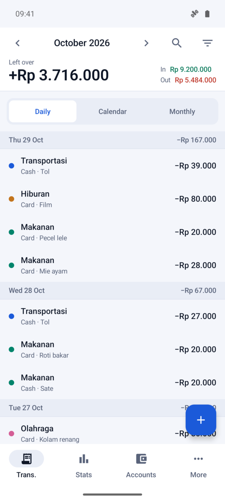
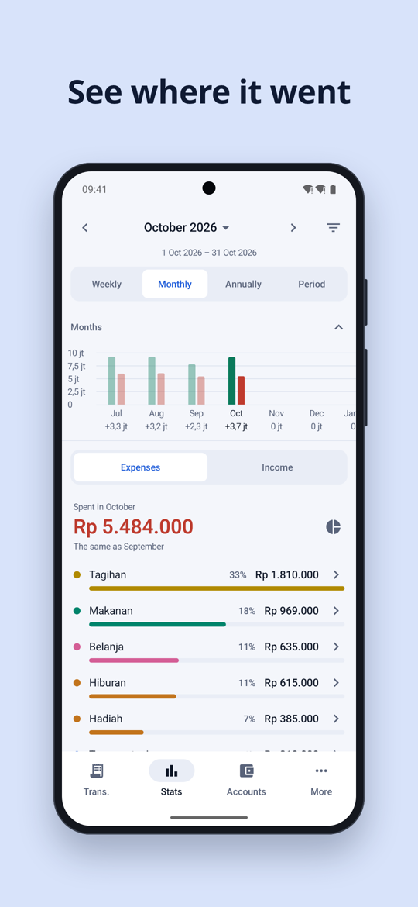
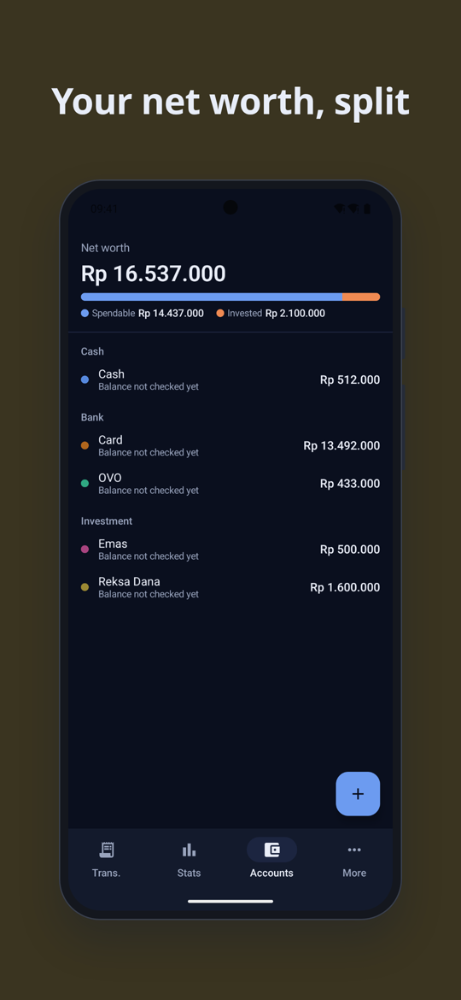
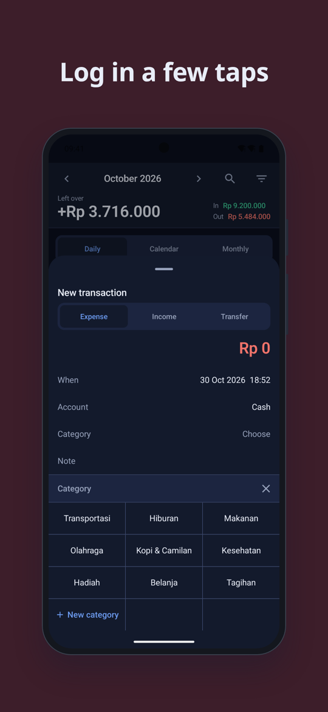

# Saku

An offline money tracker for Android, in rupiah. No ads, no account, no network. (Saku is
Indonesian for pocket.)

Think Money Manager without the ads. If you already use Money Manager, Saku imports its Excel
export, so your history comes with you.

<p>
  
  
  
  
</p>

Every screenshot uses the mock data in `data/mock-money-manager.xlsx`, not anyone's real
money. More in [`docs/screenshots/`](docs/screenshots/).

## What it does

- **Trans**: a day-by-day list, a monthly view and a calendar. On the calendar, tap two dates or drag
  across them and you get the total for that range plus every row, grouped by day.
- **Search**: type "kopi" and you get the count, the totals, a month-by-month breakdown and the rows
  themselves. This replaces subcategories, which Saku does not ask for.
- **Entry**: amount keypad with `+` and `-` for quick sums, note suggestions from what you typed
  before, and category and account pickers laid out as a grid.
- **Stats**: the period total over ranked categories, a pie you can switch on and tap, and a strip of
  past periods with a real Y axis.
- **Accounts**: Cash, Bank, Investment and Liability, with net worth split into spendable and
  invested. Reconcile writes a visible adjustment instead of quietly changing a balance.
- **Pay cycle**: months can follow your payday instead of the calendar.
- **Weekly reminder**: a notification on the day and time you pick if you have not logged anything.
- **Your data**:
  - import a **Money Manager Excel export**, with a preview, account mapping and duplicate detection
  - import and export Saku's own Excel format
  - back up everything to one file and restore it on another phone
  - import a prepared Saku `.db` file

Import only ever adds rows. Nothing is deleted or overwritten by an import or a restore.

## Privacy

- The app has no `INTERNET` permission. A Gradle check fails the build if one shows up in the merged
  manifest, including from a dependency.
- Android cloud backup is off, so `saku.db` stays on the phone.
- Exports and backups are written through the system file picker, to the place you choose.

## Build it

You need a full JDK 17 to 22 (with `jlink`) and the Android SDK.

```bash
./gradlew assembleDebug        # APK in app/build/outputs/apk/debug/
./gradlew testDebugUnitTest    # unit and Room tests, on the JVM through Robolectric
```

On a machine with little RAM, this is the command I use:

```bash
./gradlew --no-daemon -Pkotlin.compiler.execution.strategy=in-process \
  -Dorg.gradle.jvmargs=-Xmx1536m :app:testDebugUnitTest :app:assembleDebug
```

Toolchain: Gradle 8.9, AGP 8.7.3, Kotlin 2.0.21, Compose BOM 2024.10.01, Room 2.6.1,
compileSdk 35, minSdk 26.

## Tests and CI

- Unit tests run on the JVM, including the Room queries, through Robolectric.
- GitHub Actions runs unit tests, lint, the debug build and the no-network check on every pull
  request. A push to `master` builds a signed release APK and uploads it as the `saku-release-apk`
  artifact.
- Signing needs keys stored as repository secrets, so a fork builds debug APKs only.
- [Maestro](https://github.com/mobile-dev-inc/Maestro) flows live in `.maestro/flows/`. They are not in
  CI yet; run them against an emulator with `maestro test .maestro`.

## Contributing

See [CONTRIBUTING.md](CONTRIBUTING.md).

## License

[MIT](LICENSE)
